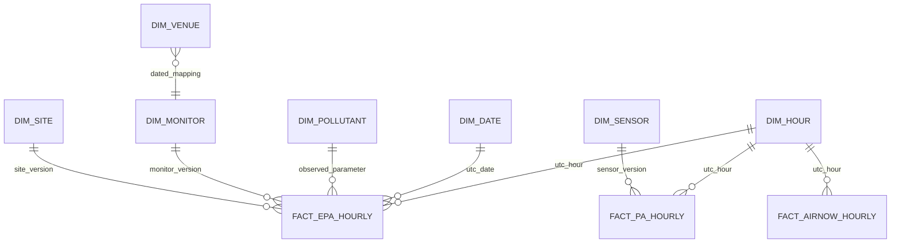

# S13: committed EPA data in Snowflake

## Current scope and evidence

The implementation is prepared for **2026 only**, commit
`aq-s12-2026-20261109221230`, generation `1794262923562000`: **50 files,
514,136,327 bytes, 6,988,009 rows**. The GCS preflight succeeded. See
[the generated load plan](../output/warehouse/aq-s12-2026-20261109221230/load_plan.json).
This is preparation evidence, **not a claim that Snowflake has loaded rows**.
The user confirmed an available trial account with ACCOUNTADMIN; account
identifier, username, and browser authentication are still needed.

Python is **3.15** throughout. Snowflake Connector **5.2.0** was installed
and imported on Python 3.15.2. The SQL executes in Snowflake; Python controls
manifest validation, reference normalization, and transactions.

## Model and grains



| Table | Grain / interpretation |
| --- | --- |
| `fact_epa_hourly` | Monitor key × UTC hour. Preserves every curated field, exact sample time, source year, file/generation, batch, and dimension surrogate keys. |
| `fact_pa_hourly` | Sensor × UTC hour after S16 QC; empty in this S13 scope. |
| `fact_airnow_hourly` | AirNow site × pollutant × UTC hour, latest revision; empty until S14. |
| `dim_pollutant` | Observed parameter STRING; `LEAD` is never a parameter value. |
| `dim_date` | Calendar date; usable in UTC and Chicago date roles. |
| `dim_hour` | Unique UTC hour, plus UTC date/hour and Chicago date/hour/offset. Repeated fall DST 01:00 hours remain distinct. |
| `dim_site`, `dim_monitor`, `dim_sensor`, `dim_venue` | SCD2 natural key × supported effective instant, with stable hash surrogate, `row_hash`, half-open validity, and `is_current`. Typed common attributes plus the complete tracked attribute object. |
| `dimension_event` | Immutable dated source event; conflicting attributes at the same key/instant are rejected. |
| `warehouse_commit`, `warehouse_load_file` | Current loaded archive-year commit and its exact source file versions. |

Snowflake standard-table primary keys document the grain; they are not used
as an enforcement mechanism. The loader explicitly checks uniqueness,
commit lineage, and counts before committing. Facts use `TIMESTAMP_NTZ(6)`
with a documented UTC meaning and session `TIMEZONE=UTC`. Parquet logical
types are enabled, including UTC microsecond timestamps. Partition `year`
and `pollutant` are populated from the validated manifest paths as INT and
STRING; they are not inferred from Parquet payloads.

The EPA table records a date/pollutant clustering key. Automatic reclustering
is suspended for the pilot. `AQ_XS` is X-Small, auto-suspends after 60 seconds,
and has a 600-second statement timeout. No Snowpipe, scheduled task, full
historical backfill, or paid-account upgrade is enabled by this work.

## Defensible dimension history

The initial site and monitor events use the exact immutable S07 ZIP
generations in [warehouse_references.json](../config/warehouse_references.json).
These are the same snapshots normalized into Cloud SQL, downloaded with
generation preconditions and verified SHA-256/byte/row counts. Reusing them
avoids requiring a new Cloud SQL administrator password or inventing history
from a current-row table. The reference record includes source URI/generation.

Both snapshots have extraction date **2026-06-26**. Initial metadata validity
starts on that date at 00:00 UTC, explicitly marked as day-precision snapshot
evidence, not the actual historical time of a move or method change. Earlier
facts resolve to surrogate **`'0'` (unknown)**. Source observation coordinates
and method codes remain available in the facts even when a dimension is
unknown. `First Year of Data` and `Last Sample Date` never become invented
monitor start/closure dates. Site activity dates are retained separately.

The caller prepares version tables from existing plus incoming source events.
`apply_dimension_events()` uses MERGE to insert new events/versions and close
changed intervals. Consecutive identical hashes create no extra dimension
version. Replay does not change existing rows. Conflicting same-instant
evidence aborts the load. Late documented events can split an interval;
surrogate keys are stable for unchanged boundaries. Facts are re-keyed within
the same transaction so their dimension version remains valid at observation
time. Unknown site/monitor counts are included in the load report.

`warehouse.check_history` runs the actual procedure in a disposable schema:
monitor move, method change, closure, unchanged snapshot, replay, earlier
unknown history, point-in-time lookup, DST offsets, and rollback. It removes
only its own randomly named test schema. Local Python tests also exercise
the history rules, but do not substitute for this Snowflake test.

## Exact loading and atomic publication

1. Read `_commits/2026.json` at a fixed generation. Validate its year, verified
   status, batch-specific file names, unique URIs, bytes, and source/pollutant
   row reconciliation. Never enumerate the curated data directory.
2. Hold a warehouse-wide loader lock plus the shared S12 year lock. S13, S12,
   cleanup, and future S14 dimension writers must respect these locks.
3. Verify every listed **live** object generation, size, and MD5. Snowflake
   external stages read live URLs, so merely finding an archived generation
   is insufficient.
4. COPY exactly `FILES=(...)` into a session-local raw table, in groups of at
   most 1,000 files. The 2026 plan contains one list of 50 files. `PURGE=FALSE`,
   `ON_ERROR=ABORT_STATEMENT`; no wildcard or `PATTERN` discovery is used.
5. Create typed staging and dimension version tables. Verify file coverage,
   identifiers/hour alignment, one monitor-hour key, and counts by pollutant.
6. Begin a transaction **after all DDL**. Apply dimension MERGEs, re-key facts,
   replace only the requested archive-year facts, and update commit/file
   ledgers. Verify warehouse counts and recheck all GCS versions before COMMIT.
   Any exception rolls back the promotion. Temporary staging is session-local.
7. Replay the same commit/reference digest: verify the fact counts and file
   ledger, return `unchanged`, and perform no second COPY or fact replacement.

If interrupted, inspect the process/query before releasing its exact GCS lock
generation. Never release a lock belonging to a live publisher or loader.
If the SQL COMMIT succeeded but a report write failed, rerunning verifies the
warehouse ledger and returns `unchanged` instead of duplicating rows.

## Step-by-step account handoff and execution

The project code, dependencies, SQL, and GCS preflight are already prepared
on this machine. The immediate human handoff is steps 1–2 below; the agent can
perform the remaining steps once authentication is available.

1. Sign in to the existing **trial** account. In a SQL worksheet run:

   ```sql
   SELECT CURRENT_ORGANIZATION_NAME() || '-' || CURRENT_ACCOUNT_NAME()
              AS ACCOUNT_IDENTIFIER,
          CURRENT_USER() AS USERNAME,
          CURRENT_ROLE() AS ROLE;
   ```

   Share only account identifier and username, or put them in the existing
   ignored `.env` file. Do not send a password, token, or private key to chat.
   Account details in Snowsight also supplies this identifier.

2. Set these local `.env` values (replace the first two placeholders):

   ```dotenv
   AIR_QUALITY_SNOWFLAKE_ACCOUNT=organization-account
   AIR_QUALITY_SNOWFLAKE_USER=your_username
   AIR_QUALITY_SNOWFLAKE_AUTHENTICATOR=externalbrowser
   AIR_QUALITY_SNOWFLAKE_ROLE=AQ_LOADER
   AIR_QUALITY_SNOWFLAKE_DATABASE=AIR_QUALITY
   AIR_QUALITY_SNOWFLAKE_SCHEMA=ANALYTICS
   AIR_QUALITY_SNOWFLAKE_WAREHOUSE=AQ_XS
   ```

   Keep password/token empty for browser authentication. When the connector
   opens the browser, complete login/MFA there. If the account does not support
   this browser authentication flow, configure an account-approved key-pair
   or programmatic token locally; do not weaken the account's MFA policy.

3. Bootstrap the schema/integration using ACCOUNTADMIN:

   ```sh
   .venv/bin/python -m pip install -e '.[dev,gcp,warehouse]'
   .venv/bin/python -m warehouse.load bootstrap
   ```

   It creates `AQ_LOADER`, grants it to the connected user, and prints the
   nonsecret `STORAGE_GCP_SERVICE_ACCOUNT`. Reviewed generated SQL is in
   `output/warehouse/aq-s12-2026-20261109221230/`. Existing integrations are
   not replaced, preserving their service identity.

4. Set `snowflake_storage_service_account` to that exact email in the ignored
   `infra/terraform.tfvars`. Then review and apply the Terraform plan:

   ```sh
   terraform -chdir=infra plan -out=s13.tfplan
   terraform -chdir=infra apply s13.tfplan
   ```

   Expected S13 changes: one custom read role and one bucket binding. It grants
   bucket metadata/listing and object reads under `curated/`, with no create,
   overwrite, delete, or purge permissions. Do not change the bucket identity
   or recreate existing resources. IAM propagation may require a retry.

5. Verify the connection and actual SCD2 procedure:

   ```sh
   .venv/bin/python -m warehouse.load check
   .venv/bin/python -m warehouse.check_history
   ```

6. Load only 2026, then repeat to verify idempotency:

   ```sh
   .venv/bin/python -m warehouse.load prepare --year 2026
   .venv/bin/python -m warehouse.load load --year 2026
   .venv/bin/python -m warehouse.load load --year 2026
   ```

   Expected: first `loaded` with 6,988,009 rows; second `unchanged`. Inspect
   `load_result.json`, `replay.json`, and `history_check.json` before claiming
   S13 acceptance. `load_result.json` includes an uncached Chicago PM2.5 monthly
   query ID and elapsed time; the target is under ten seconds on X-Small.

## S14 handoff and acceptance limits

Live landing tables are `landing_pa_reading`, `landing_pa_sensor_history`,
`landing_airnow_obs`, and `airnow_obs_history`. They preserve raw grain and
revision lineage; no live sync occurs in this task. Sensor and venue SCD2
tables contain only unknown members until supported S14/S18 events arrive.
Cloud SQL `process_state` remains unchanged; the warehouse commit ledger is
the S13 load record.

`chicago_epa_hourly` covers the seven study counties. The monthly PM2.5 view
is sample-weighted, separates parameter and source unit basis, and excludes
negative, advisory-superseded, and non-hour-aligned measurements from its
mean while reporting their counts. It is an analytical query, not a
regulatory statistic or the final S19 scheduling analysis.

Sources: [Python 3.15 connector support](https://docs.snowflake.com/en/developer-guide/python-connector/python-connector-install),
[account identifiers](https://docs.snowflake.com/en/user-guide/admin-account-identifier),
[GCS integration permissions](https://docs.snowflake.com/en/user-guide/data-load-gcs-config),
[COPY FILES and Parquet logical types](https://docs.snowflake.com/en/sql-reference/sql/copy-into-table),
[transaction boundaries](https://docs.snowflake.com/en/sql-reference/transactions),
[automatic clustering controls](https://docs.snowflake.com/en/user-guide/tables-auto-reclustering).
